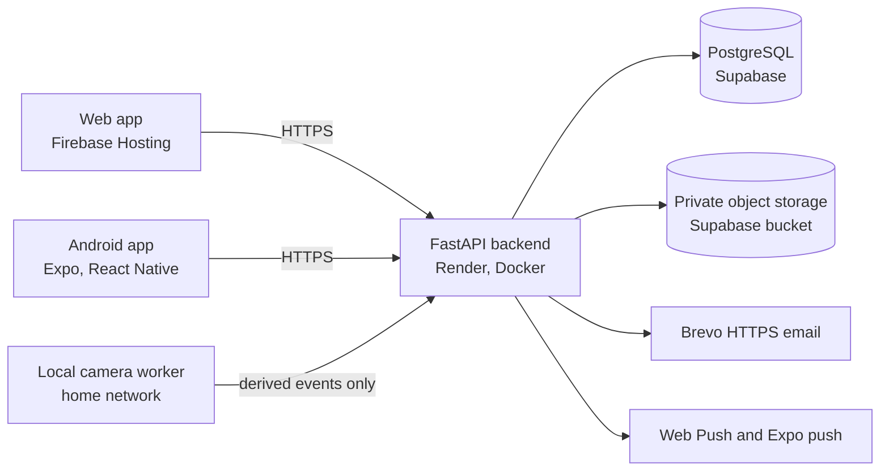

# HealthBook AI

**Your private family health workspace.**

HealthBook AI is a privacy-first longitudinal family health-record platform combining secure medical-document management, human-verified extraction, medication and vaccination history, daily health tracking, clinical timelines, selective PDF export, doctor sharing, and web/mobile access.

<p>
  <a href="https://github.com/dranubhaparashar/HealthBook-AI/wiki"><b>📘 Technical Wiki</b></a> &nbsp;·&nbsp;
  <a href="https://github.com/dranubhaparashar/HealthBook-AI"><b>GitHub Repository</b></a> &nbsp;·&nbsp;
  <a href="https://childcare-2c3ab.web.app"><b>Live Application</b></a>
</p>

> **This is a sanitized public technical showcase.**
> Production infrastructure, credentials, source medical documents and patient records are maintained separately and are not included in this repository. All examples and test data are synthetic.

The engineering documentation (architecture diagrams, data model, security model, API design and every feature pipeline) lives in the **[Technical Wiki](https://github.com/dranubhaparashar/HealthBook-AI/wiki)**. The internal code name is *BabyCare*, which is why environment variables and packages use the `BABYCARE_` prefix.

## Purpose

Families accumulate years of prescriptions, lab reports, vaccination cards, discharge summaries and day-to-day observations across paper, phones and clinics. HealthBook AI keeps the original documents, turns them into structured records only after a person has checked them, and presents one evidence-linked history per family member that can be exported or shared with a clinician on the family's terms.

## Architecture at a glance



The same API serves the web client and the Android app. Clinical text fields and original files are encrypted at the application layer before they reach the database or the private bucket. A local self-hosted mode uses SQLite and an encrypted local file store instead of Supabase.

## Key capabilities

| Area | What it does |
| --- | --- |
| Medical documents | Upload PDFs and photos, duplicate detection by hash, encrypted private storage, page previews |
| Extraction and review | Local OCR produces *suggestions*; a person verifies each item against the original before it becomes a record |
| Medicines | Prescriptions, revisions and verification kept separate from doses actually given |
| Vaccinations | Card transcription, due dates kept separate from administrations, confirmed-appointment reminders |
| Labs and growth | Original units and printed reference ranges, unit-safe trend charts, growth and vitals |
| Illness history | Admissions, visits, illness episodes, an evidence-linked timeline and a Lifetime Health view |
| Daily Health | Fluids, diapers, stool (with optional photo observation), medicines given, symptoms, sleep, activity, Care Calendar |
| Export and sharing | Selective clinician PDF with source references, and expiring, optionally PIN-protected doctor links |
| Family profiles | Several isolated profiles per account, caregiver invitations with viewer or editor roles |
| Notifications | Reminders only for confirmed plans; acknowledging a reminder never records a dose |
| Home camera | Optional local worker that sends derived activity events for caregiver review; raw video stays at home |
| Ask Records | Source-grounded retrieval that cites the stored records it used; it never diagnoses |

## Clinical safety rules built into the data model

- Prescribed ≠ scheduled ≠ given. Each is a separate record.
- OCR-extracted text is a suggestion, not a clinically verified fact.
- A vaccination due date is not an administered vaccination.
- An appointment or hospital attendance is not a treatment administered.
- Culture susceptibility is not evidence that an antibiotic was received.
- The software never prescribes or changes a dose.
- Stool-image interpretation is observational only and not a diagnosis.
- Parent-entered information stays distinguishable from clinician documentation, and structured records keep provenance to the original document page.

## Technology stack

| Layer | Technology |
| --- | --- |
| Backend | Python 3.12, FastAPI, SQLAlchemy, Alembic, Pydantic, Uvicorn |
| Database | PostgreSQL on Supabase (SQLite for local mode) |
| Storage | Private Supabase Storage bucket (encrypted local files for local mode) |
| Documents | PyMuPDF, Tesseract via pytesseract, Pillow, server-side PDF generation |
| Security | Fernet application-layer encryption (`cryptography`), hashed sessions and tokens |
| Web | Vanilla HTML, CSS and JavaScript PWA with a service worker, Firebase Hosting |
| Mobile | React Native with Expo and TypeScript, Android APK |
| Hosting | Render (Docker) for the API |
| Email | Brevo HTTPS API (Resend also supported; SMTP for local development) |
| Testing | pytest, Playwright, TypeScript typecheck, GitHub Actions |

Exact versions are pinned in `requirements.lock`, `package.json` and `mobile/package.json`. See [Technology Stack](https://github.com/dranubhaparashar/HealthBook-AI/wiki/28-Technology-Stack).

## Privacy model

- Every patient-scoped request passes authentication and a profile-ownership check; another family's records return *not found*.
- Session, reset and share tokens are stored only as hashes.
- Clinical text and original files are Fernet-encrypted by the application; the storage bucket is private with row-level security and no public policies.
- External AI vision is off by default and needs explicit per-document consent.
- Push notifications carry a generic sentence, never a medicine, diagnosis or name.

Details: [Security and Privacy Model](https://github.com/dranubhaparashar/HealthBook-AI/wiki/25-Security-and-Privacy-Model).

## Repository layout

| Path | Contents |
| --- | --- |
| `api/` | FastAPI application, models, domain modules, PDF export, camera worker |
| `migrations/` | Alembic migration chain |
| `web/` | Web client (no build step) and service worker |
| `mobile/` | Expo / React Native Android app |
| `tests/` | pytest suites and Playwright browser specs, all synthetic data |
| `scripts/` | Build, deployment-configuration, backup and import helpers |
| `deploy/` | Firebase and Supabase templates with placeholders only |

## Running locally (synthetic data only)

```bash
python -m venv .venv && .venv/bin/pip install -r requirements.lock
.venv/bin/python -m uvicorn api.main:app --host 127.0.0.1 --port 8000
# open http://127.0.0.1:8000 and create a demo account such as demo@example.invalid
.venv/bin/python -m pytest -q
```

Tesseract is needed for OCR of scanned pages. The bundled DejaVu fonts in `api/assets/fonts` are distributed under the DejaVu Fonts license.

## Status and license

This repository is published for technical review. It is not a medical device, has not been clinically validated, and is not offered as a hosted service from this repository. No open-source license is granted; all rights reserved unless a license file is added later.
